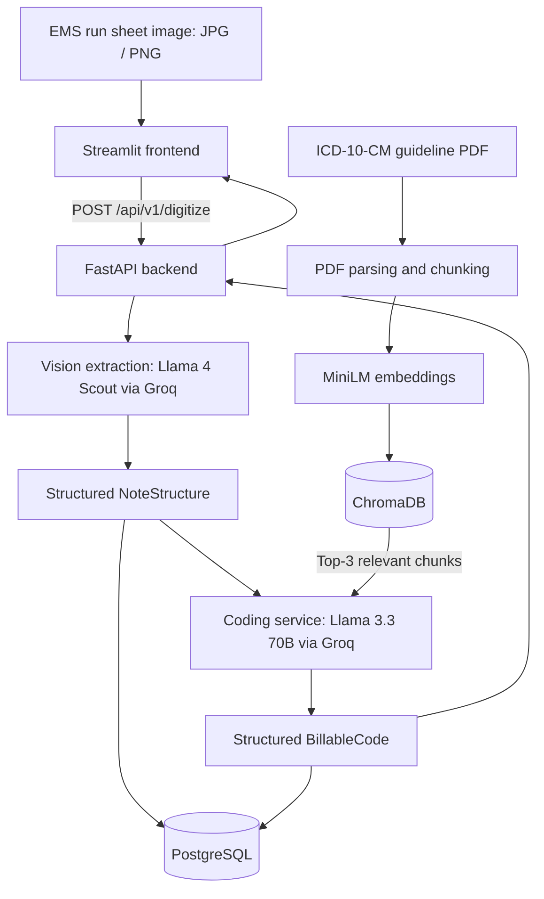

# AutoCode-MD 🩺

**Multimodal medical-document extraction and retrieval-augmented ICD-10-CM coding**

AutoCode-MD is a full-stack AI prototype that turns scanned emergency medical services (EMS) notes into structured clinical information and suggested medical billing codes. It uses a vision-language model to read handwritten ambulance run sheets, retrieves relevant ICD-10-CM guidelines, and generates a structured coding recommendation with supporting reasoning.

The application combines a **Streamlit** interface, **FastAPI** backend, **Groq-hosted Llama models**, **ChromaDB** retrieval, and **PostgreSQL** storage.

> **Prototype only:** Suggestions are not validated medical or billing decisions. A qualified coder should review every output against the complete record and current authoritative coding guidance. Do not upload real protected health information without appropriate privacy, security, and contractual safeguards.

## Features

- **Handwritten EMS note extraction:** Upload a JPG/JPEG or PNG ambulance run sheet and extract the patient/run identifier, service date, chief complaint, diagnosis/impression, and documented procedures/interventions.
- **Two-stage model workflow:** A vision model extracts structured fields, then a separate coding model produces medical coding suggestions.
- **Guideline-grounded RAG:** Retrieves relevant passages from an ICD-10-CM coding guidelines PDF stored in ChromaDB.
- **Structured responses:** Uses `instructor` and Pydantic models for typed extraction and coding results.
- **Reviewable output:** Displays an ICD-10-CM code and description, optional CPT code, explanation, and model-reported confidence score.
- **Persistence:** Stores extracted information and coding outputs in PostgreSQL through SQLAlchemy.
- **Containerized stack:** Uses Docker Compose to coordinate the application and supporting databases.

## Architecture



### How it works

1. **Upload:** A user submits a scanned EMS note in the Streamlit UI.
2. **Extract:** The vision service sends the image to the Groq API using the configured `meta-llama/llama-4-scout-17b-16e-instruct` model. Instructor validates the response against the `NoteStructure` schema.
3. **Retrieve:** The coding service constructs a query from the extracted diagnosis and interventions and retrieves the **three most similar** chunks from the guideline knowledge base.
4. **Generate:** The configured `llama-3.3-70b-versatile` model uses the extracted fields and retrieved passages to propose a code and reasoning, returned in the `BillableCode` schema.
5. **Store and display:** The backend records the result in PostgreSQL and returns it to the UI for review.

**Retrieval detail:** The ingestion pipeline reads `data/icd10_guidelines.pdf` with `PyPDFLoader`, splits the text into **500-character chunks with 50-character overlap**, and embeds those chunks using `sentence-transformers/all-MiniLM-L6-v2` before storing them in the `icd10_rules` Chroma collection.

## Technology stack

| Layer | Technology |
| --- | --- |
| Frontend | Streamlit, Requests |
| API | FastAPI, Uvicorn, Python 3.11 |
| Vision extraction | Llama 4 Scout via Groq |
| Coding generation | Llama 3.3 70B via Groq |
| Structured model output | Instructor, Pydantic |
| Retrieval | LangChain, ChromaDB, Hugging Face embeddings |
| Reference corpus | ICD-10-CM guideline PDF |
| Relational persistence | PostgreSQL, SQLAlchemy, Alembic |
| Packaging and orchestration | Poetry, Docker, Docker Compose |

**Model hosting note:** Current source code invokes **Groq-hosted** models. Despite earlier project concepts involving local Llama inference, the checked-in implementation is **not local-only**.

## Repository structure

```text
AutoCode-MD/
├── data/
│   └── icd10_guidelines.pdf        # Guideline reference document
├── src/
│   ├── backend/
│   │   ├── api/v1/routes.py         # /digitize endpoint
│   │   ├── core/settings.py         # Configuration and model IDs
│   │   ├── database/               # PostgreSQL models/CRUD and ChromaDB access
│   │   ├── ingestion/loader.py      # PDF loading and chunking
│   │   ├── services/
│   │   │   ├── vision.py            # EMS note extraction
│   │   │   └── coding.py            # RAG-assisted coding
│   │   ├── ingest_runner.py         # Knowledge-base ingestion/query CLI
│   │   ├── models.py                # Structured output schemas
│   │   └── main.py                  # FastAPI app
│   └── frontend/
│       └── app.py                   # Streamlit app
├── alembic/                         # Database migration scripts
├── docker-compose.yaml
├── pyproject.toml
└── poetry.lock
```

## Getting started

### Prerequisites

- Docker with Docker Compose
- A valid **Groq API key**
- Enough memory/storage to download and load the Sentence Transformers embedding model

### 1. Clone the repository

```bash
git clone https://github.com/hemanjalireddy/AutoCode-MD.git
cd AutoCode-MD
```

### 2. Configure the environment

Create a `.env` file in the repository root:

```dotenv
GROQ_API_KEY=your_groq_api_key_here
```

Do not commit API keys or patient data to Git. The Compose file contains **development-only PostgreSQL credentials**; replace them and configure access appropriately before deployment.

### 3. Start the services

```bash
docker compose up --build -d
```

This starts ChromaDB, PostgreSQL, the FastAPI backend, and the Streamlit frontend.

### 4. Initialize the relational database

The API saves each processed note to PostgreSQL. Apply the repository's Alembic migrations before using the upload endpoint:

```bash
docker compose exec backend alembic upgrade head
```

If migrations fail, check that the PostgreSQL service is ready and that the backend image contains the migration files. The current backend Dockerfile copies only `src/backend`, so running Alembic **inside the container may require adjusting that Dockerfile to copy `alembic/` and `alembic.ini`**. As an alternative, run migrations in a properly configured local Poetry environment.

### 5. Build the guideline knowledge base

```bash
docker compose exec backend python -m src.backend.ingest_runner --ingest
```

This loads and indexes the guideline PDF. Ingestion should be completed before requesting coding suggestions.

To check retrieval manually:

```bash
docker compose exec backend python -m src.backend.ingest_runner --query "coding guidelines for acute myocardial infarction"
```

### 6. Open the application

| Service | Local URL |
| --- | --- |
| Streamlit UI | http://localhost:8501 |
| FastAPI Swagger docs | http://localhost:8080/docs |
| API health endpoint | http://localhost:8080/health |
| ChromaDB | http://localhost:8000 |

**Note:** Docker Compose maps the backend's internal port `8000` to host port `8080`.

## API

### `POST /api/v1/digitize`

Upload an EMS note image as multipart form data using the `file` field.

```bash
curl -X POST http://localhost:8080/api/v1/digitize \
  -F "file=@path/to/sample_ems_note.jpg"
```

Accepted MIME types: `image/jpeg`, `image/png`, and `image/jpg`.

Illustrative response shape (not an actual model result):

```json
{
  "status": "success",
  "data": {
    "extracted_data": {
      "patient_id": "DEMO-001",
      "date_of_service": "2026-01-01",
      "chief_complaint": "Chest pain",
      "diagnosis_text": "Example field impression",
      "procedure_text": "Example documented intervention"
    },
    "coding_result": {
      "icd10_code": "EXAMPLE",
      "icd10_description": "Illustrative placeholder, not a real code",
      "cpt_code": null,
      "reasoning": "Illustrative reasoning based on documentation and retrieved guidelines.",
      "confidence_score": 0.8
    }
  }
}
```

**Confidence warning:** `confidence_score` is produced by the language model; the repository does not currently demonstrate that it is statistically calibrated. It should not be treated as a measured probability of correctness.

### `GET /health`

Returns the backend health response:

```json
{"status":"healthy","service":"backend"}
```

## Limitations and opportunities

This repository is a working prototype with several important areas for further engineering:

- **Code verification:** Add authoritative ICD-10-CM code-set validation, version tracking, and rules for incompatible or unsupported codes.
- **CPT validation:** The response schema permits a CPT suggestion, but the retrieved knowledge base is an ICD-10-CM guideline PDF, not a complete CPT reference source.
- **Confidence calibration:** Evaluate model confidence against a manually reviewed dataset before using confidence in decisions.
- **Retrieval evaluation:** Measure guideline-retrieval quality with Recall@K and source relevance, alongside code-level accuracy.
- **Sensitive-data protection:** Implement authentication, authorization, encryption, retention policies, audit logging, and relevant compliance controls before using real patient data.
- **Deployment hardening:** Replace development credentials, add readiness checks and robust startup ordering, and ensure database migrations run reliably.
- **Automated tests:** Add unit, integration, and end-to-end tests for ingestion, image handling, structured output, retrieval, persistence, and invalid requests.

## Responsible use

AutoCode-MD is an **experimental decision-support prototype** and is not a certified medical coding system. Its output may be incomplete or inaccurate, and retrieved text does not guarantee that a generated code is valid. Always check coding suggestions against authoritative sources and have appropriately qualified professionals review them before use in real clinical or reimbursement workflows.

---

Built as an applied AI engineering project exploring **multimodal extraction, retrieval-grounded generation, structured LLM outputs, and full-stack AI application development**.
